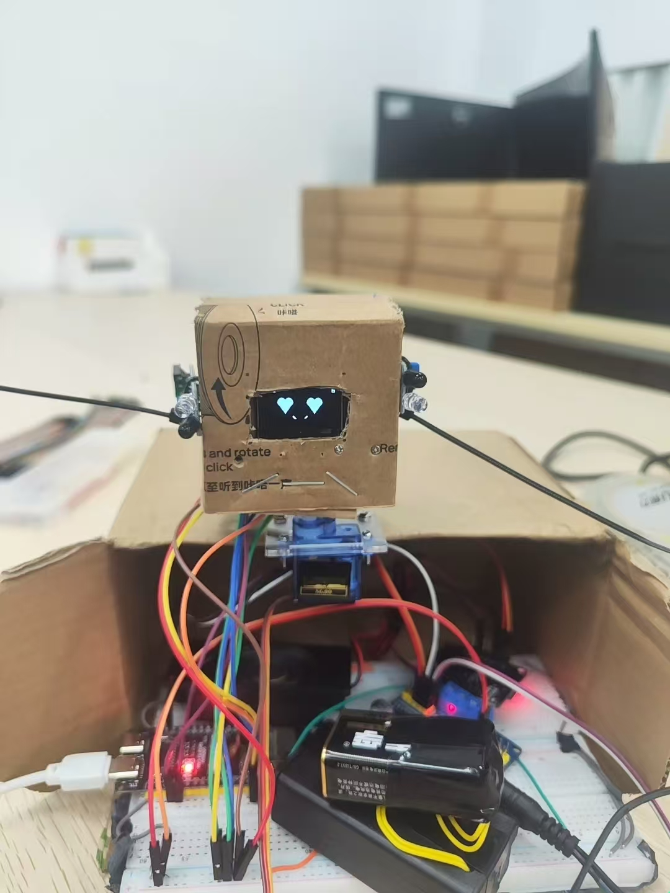

# Paper Robot — Voice Interactive Edition

[中文说明](README.md) · [Wiring](docs/wiring.md) · [Getting started](docs/quickstart.md)

Inspired by cardboard desktop robots, this project reuses parts from an earlier robot car. This edition adds **ASRPRO offline voice interaction and richer OLED expressions**, connecting guided voice prompts with two proximity sensors and servo head movement.

Call its name, follow a left/right cheek invitation, and it responds with a face, a turn, and a spoken reward. It then invites you to the other cheek or suggests a compliment / another round. Free proximity interaction also works without voice wake-up.

The author has completed the working electronic prototype and a cardboard head. The supplied photograph and approximately 68-second video show the current build. Reusable enclosure dimensions and printable templates are still to be documented.

[View the demonstration video](assets/demo.mp4) · [Download the original video](https://github.com/Eating-King-Git/paper-hajimi/raw/refs/heads/main/assets/demo.mp4)

Hardware: GOOUUU ESP32-S3-CAM V1.5, SSD1306 128×64 I²C OLED, ASRPRO V2.0 with speaker, two active-low IR proximity modules, and one separately powered SG90 servo.

Current entry points:

- ESP32: `firmware/DeskPetFaceGame/DeskPetFaceGame.ino` (keep both headers beside it).
- ASRPRO: `firmware/ASR_DeskPetFaceGame/哈吉米_连续互动_v9_3.hd` (Tianwen Block ASRPRO professional mode).
- Commands and responses: `interaction/phrases.v0.9.json`.
- Test the controller: `python tools/test_face_game.py` with a C++ compiler.

Voice recognition uses configured Chinese command variants. Playback uses pre-generated phrases. This is **not a conversational LLM, arbitrary runtime TTS, or guaranteed full-duplex voice system**. The camera is not enabled; IR senses proximity, not pressure.

Both boards require matching firmware resources. See the Chinese step-by-step documentation for single-USB flashing, exact board pin assignments, power, and troubleshooting. Other boards require their own pin verification.

Original source and documentation: [GPL-3.0-only](LICENSE). Vendor SDKs, tools, and generated speech assets are not redistributed. [Credits](docs/credits.md).

If this helps you build your first little robot, a **Star** is appreciated. Reproduction reports, photographs, and contributions are welcome.
