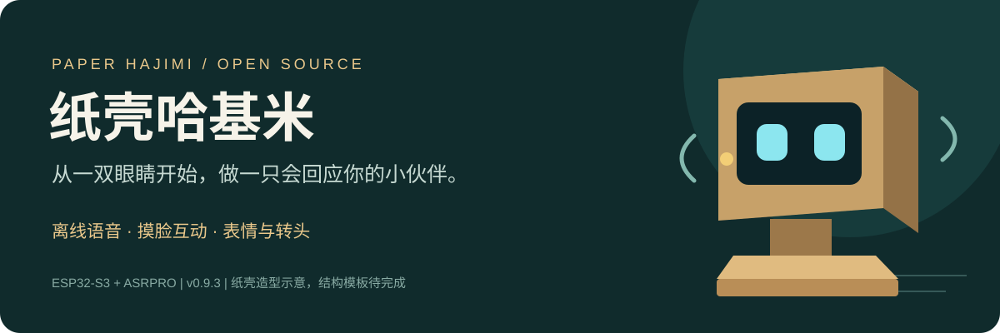
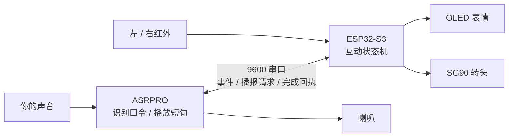

# 纸壳哈基米 · Paper Hajimi

**从一双眼睛开始，做一只会主动邀请你互动的桌面小伙伴。**

ESP32-S3 · ASRPRO 离线语音 · OLED 表情 · 双侧红外 · SG90 转头

[开始制作](docs/quickstart.md) · [全部接线](docs/wiring.md) · [语音互动怎么玩](docs/interaction.md) · [排错指南](docs/troubleshooting.md) · [English](README.en.md)

你叫一声“哈基米”，它不只回答“我在”。

> 🤖「我在呢！来摸摸我的左脸吧！」  
> 👋 你把手靠近左脸——它笑起来，转过头。  
> 🤖「嘿嘿，好舒服。来摸摸我的右脸吧！」  
> 🤖「好开心！你可以说，你好可爱，或者，再来一次。」

这是一个受“小纸壳机器人”系列启发、利用旧小车零件从零搭起来的桌面机器人项目。这个版本的特色，是**加入独立的 ASRPRO 离线语音模块，让语音引导、左右脸感应、表情和转头形成连续互动**。它既能回应你，也会告诉你接下来可以怎么玩。

**当前版本 v0.9.3：电子互动样机已由作者反馈完成并可用；纸壳外观与结构模板尚未制作。** 名字代表项目的起点和后续造型方向，首页插图是设计示意，不是成品照片。

如果这个项目让你想起自己的第一块开发板，或者帮你做出了第一只小机器人，欢迎点一下右上角 **⭐ Star**。也欢迎通过 Issue 分享复刻照片和改进建议。

## 为什么想做它

最初刷到纸壳小机器人时，吸引我的不是复杂的算法，而是两只眼睛、一个转头，就能让纸盒显得有了性格。

手边刚好有做 STM32 小车时留下来的零件，于是从点亮 OLED 开始，一步步加上感应、语音和舵机。过程里遇到过端口连接不上、表情没有变化、语音能听到却无法联动，以及少接一根 PA3 返回线的问题。这些经验整理成了可以跟着做的文档。

本项目的灵感来源见[致谢与来源](docs/credits.md)，不是原视频作者的官方配套代码。

## 它现在会什么

| 能力 | 实际表现 |
|---|---|
| 主动邀请 | 唤醒后直接指定左脸或右脸，不需要猜下一句口令 |
| 连续互动 | 摸对→奖励→换另一边→邀请夸奖或再玩 |
| 同类说法 | “你好可爱 / 你很可爱 / 你真可爱 / 好可爱”触发同一个夸奖事件 |
| 随机回应 | 夸奖和摸对奖励各有三种回应，相邻不重复 |
| 自由摸脸 | 不用先唤醒，靠近左右红外也有表情和转头反馈 |
| 表情与动作 | OLED 动画、左右转头、轻摆、自动回中 |
| 容错引导 | 摸错侧、同时遮住两边、长时间没有操作时给出提示 |
| 离线运行 | 运行时不依赖 Wi-Fi 或云端聊天服务；语音资源需在天问中事先生成 |

红外检测的是靠近或遮挡，不是真正的触摸压力。语音是**已配置口令的离线识别＋预生成短句播放**，不是任意语义理解或大模型自由聊天；也不保证一边播报一边识别。板上摄像头暂未启用，电机、身体升降和摸头感应尚未实现。

## 复刻需要什么

| 元件 | 数量 | 本项目使用 |
|---|---:|---|
| ESP32-S3 开发板 | 1 | GOOUUU ESP32-S3-CAM V1.5，TTL/OTG 双 USB |
| OLED 屏幕 | 1 | SSD1306，0.96英寸，128×64，四针 I²C |
| 离线语音模块 | 1 | ASRPRO V2.0，天问 Block 编程 |
| 匹配的喇叭 | 1 | 接 ASR 板 SPK 插座 |
| 红外避障模块 | 2 | OUT/GND/VCC，3.3V供电，低电平触发 |
| SG90 舵机 | 1 | 左右转头 |
| 独立稳压5V供电及接线 | 1套 | 示例使用蓝色多路降压板给舵机供电，共地 |
| USB数据线、杜邦线 | 若干 | 只有一根USB也可分步烧录 |

具体电源约束、板型差异和未使用零件见[硬件说明](docs/hardware.md)。**不要把9V直接接到舵机或ESP32的5V脚。**

## 从哪里开始

1. 阅读[接线表](docs/wiring.md)，断电连接屏幕、两只红外和两板串口。
2. 在天问打开 [V9.3语音工程](firmware/ASR_DeskPetFaceGame/哈吉米_连续互动_v9_3.hd)，生成资源、编译并下载。
3. 在 Arduino 打开 [DeskPetFaceGame.ino](firmware/DeskPetFaceGame/DeskPetFaceGame.ino)，保持同目录两个头文件，上传 ESP32。
4. 断电恢复单USB联调接线，USB插ESP32的 **TTL**，打开115200串口监视器。
5. 看 `link=1`，叫“哈吉米”（“哈基米”同音），跟随邀请靠近左右脸。

完整步骤与 Arduino 设置在[快速开始](docs/quickstart.md)。**两块板都需要对应版本；只更新ESP32可能缺少新语音资源。**

## 仓库导航

| 位置 | 内容 |
|---|---|
| `firmware/DeskPetFaceGame/` | 当前完整ESP32工程、控制器和协议 |
| `firmware/ASR_DeskPetFaceGame/` | 当前天问`.hd`、C++对照代码及语音逻辑 |
| `interaction/phrases.v0.9.json` | 14条口令和20条播报资源；具体版本字段为0.9.3 |
| `firmware/DeskPetScreen/` | 学习阶段一：先点亮两只眼睛 |
| `firmware/DeskPetInteraction/` | 学习阶段二：加入单路红外 |
| `firmware/DeskPetVoice/` | 学习阶段三：语音事件联动 |
| `docs/` | 接线、烧录、玩法、开发过程、协议、验证与排错 |
| `tools/` | 代码生成、可移植逻辑测试、资源一致性校验 |

历史阶段用于学习，不要把旧阶段的串口协议和接法与当前版混用。见[从零制作过程](docs/build-log.md)。

## 验证与下一步

- 作者反馈：当前电子互动样机已完成并可用。
- ESP32：在Arduino ESP32 core 3.3.10上编译通过，354543B程序、24820B静态RAM。
- 控制器：96项C++检查通过，覆盖连续互动、消抖、超时、退出与协议解析。
- ASR：资源配对及厂商SDK目标文件编译已检查；每个复刻者仍需使用自己的天问环境生成语音资源并下载。
- 后续：纸壳外观/结构模板、成品视频、更多互动；摄像头和身体动作作为独立后续阶段。

详见[验证记录](docs/validation.md)和[路线图](docs/roadmap.md)。欢迎先复刻已完成部分，再一起改进。[贡献说明](CONTRIBUTING.md)

## 许可证与致谢

本仓库原创代码和文档采用 **[GNU GPL v3.0](LICENSE)**（`GPL-3.0-only`）。厂商工具链、SDK、语音引擎及生成音频不包含在仓库中，相关权利与使用条件由各自提供方决定。

灵感来自“小纸壳机器人”系列及参考作品。感谢截图中 **@林缘** 的作品和 **@Made by Z** 的制作教程，也感谢提供开发工具和硬件文档的社区与厂商。完整说明见[来源与第三方边界](docs/credits.md)。
