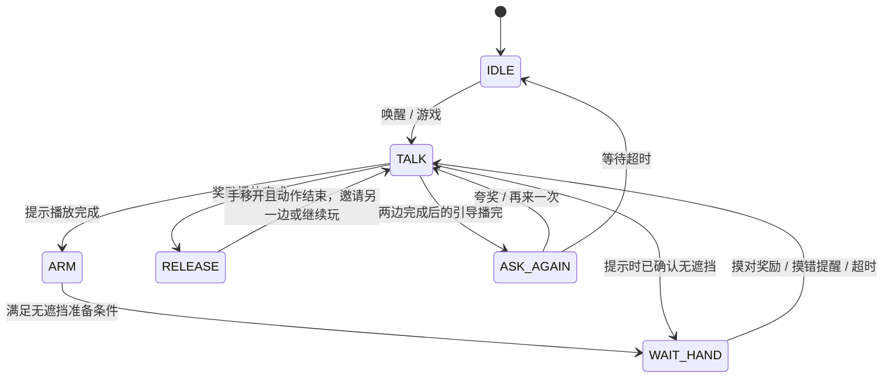

# 两块板怎样配合

ESP32负责表情、红外采样、互动状态和舵机；ASRPRO负责识别口令、播放预生成语音及报告播放完成。运行时没有云端调用。

## 串口

ASCII文本、换行结束，9600 / 8N1。

| 方向 | 消息 | 作用 |
|---|---|---|
| ESP→ASR | `HELLO` | 请求握手 |
| ASR→ESP | `READY,9` | 协议就绪；9是协议版本，不是资源修订号 |
| ASR→ESP | `EVT,WAKE`等 | 识别后的统一事件 |
| ESP→ASR | `PLAY,123,1060` | 请求播放ID1060，请求序号123 |
| ASR→ESP | `ACK,123` | 接受请求 |
| ASR→ESP | `DONE,123` | SDK播放完成回调 |
| ASR→ESP | `ERR,123,RESOURCE`等 | 无资源、忙、播放失败或超时 |

事件包括WAKE/PRAISE/GAME/AGAIN/EXIT/REST/FORWARD/BACK。不同夸奖句归一到PRAISE。旧阶段的十六进制0x47/0x51不是当前协议，不能混用。

请求序号用于避免把迟到回复算到下一句。ASR只允许一个在播请求；播放超时后等待真实回调，以免误报另一句完成。ESP无ACK约2秒或播放超过12秒进入故障处理；ASR播放超时约11秒。

## 状态机

`Interaction.h`不依赖Arduino，是可在电脑编译测试的控制器。外部通过Port接口请求表情、动作、音频和随机数。

这是主要流程示意，完整行为以代码为准，另有LISTEN/BETWEEN/SLEEP。TALK期间保留一个最新语音意图，EXIT/REST优先。自由摸脸只在IDLE/LISTEN/ASK_AGAIN/SLEEP运行，避免与游戏争抢反馈。

## 调度

- 两路红外分别消抖，40ms靠近、120ms释放。
- OLED逐页刷新，主循环有机会在页间处理串口、感应和舵机；并非承诺40ms端到端反应。
- 舵机逐步调节PWM，50Hz、中心1500μs、范围1300～1700μs；完成回中后释放PWM。
- 停止PWM不等于切断舵机电源。超时仅限制程序动作时长，不检测物理堵转。

修改协议/ID后，应运行测试和资源配对检查，再分别编译和烧录两板。
