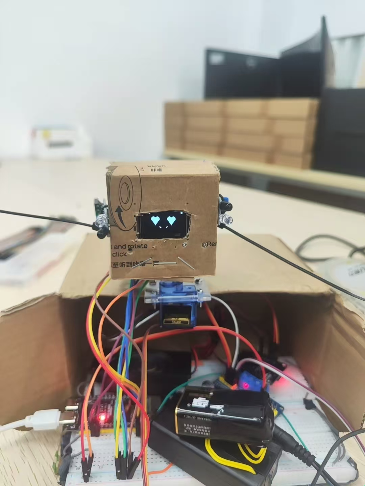

# 实物照片与演示视频

2026-11-15，作者提供当前样机的照片和视频，用于展示**纸壳机器人—语音交互式版**。

[查看演示视频](../assets/demo.mp4) · [下载原视频](https://github.com/Eating-King-Git/paper-hajimi/raw/refs/heads/main/assets/demo.mp4)

| 素材 | 信息 |
|---|---|
| 实物照片 | JPEG，1080×1440，爱心表情、纸壳头部、红外模块、舵机和内部接线 |
| 演示视频 | MP4，720×1280，约68.2秒，约7.7MB |

图片和视频保留作者提供的原文件内容。当前已经有纸壳头部实物，后续将补充装配尺寸与可复用结构模板。

复刻时请以[接线表](wiring.md)和[硬件说明](hardware.md)为准，照片用于展示样机装配。视频未附逐句字幕，具体口令和流程可查[互动说明](interaction.md)。
